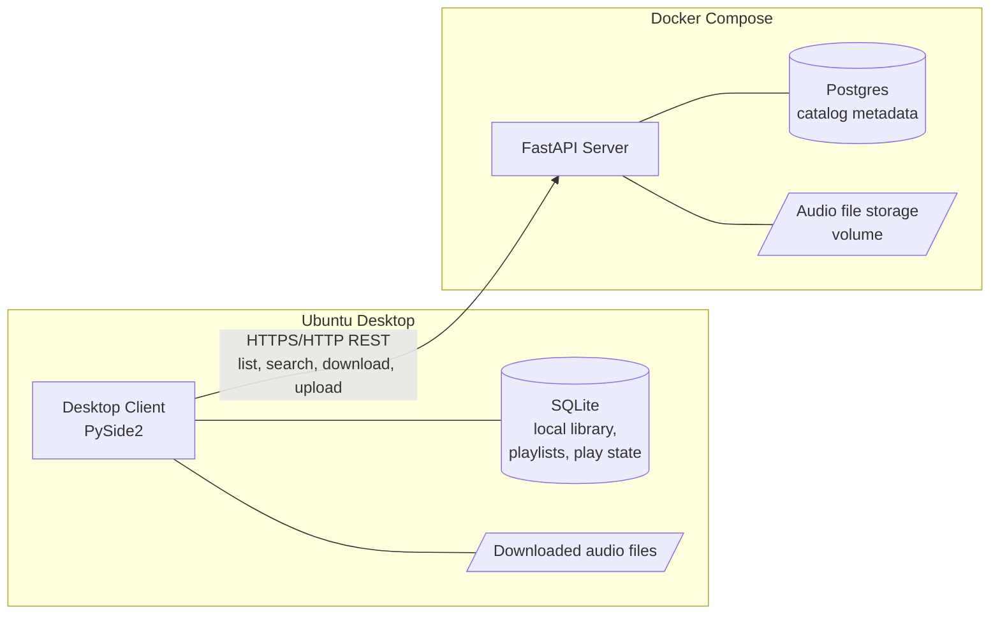
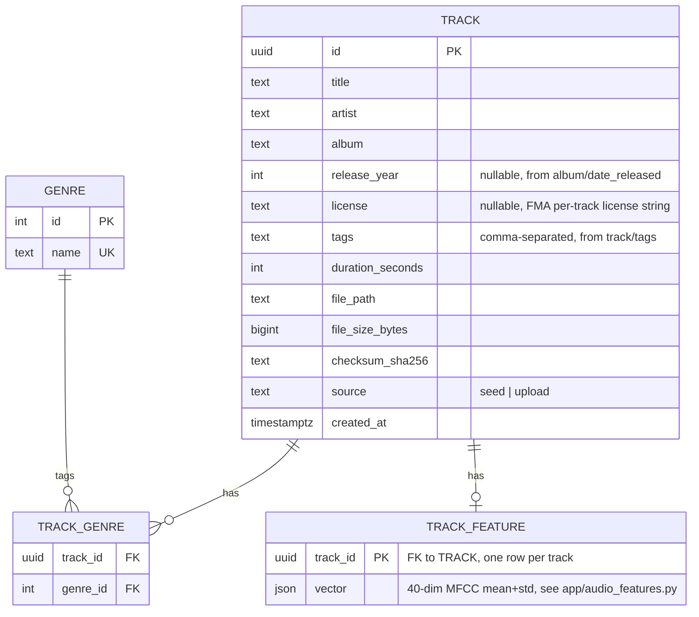
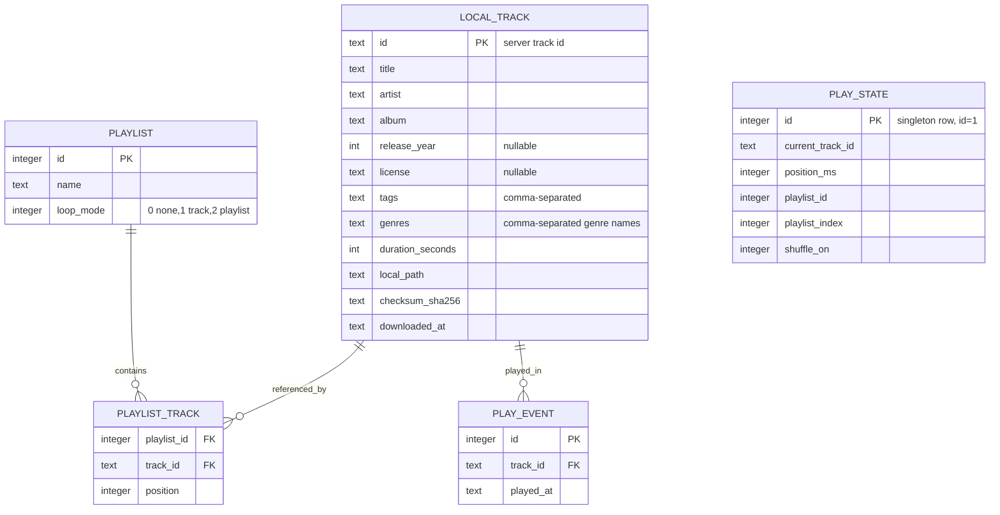
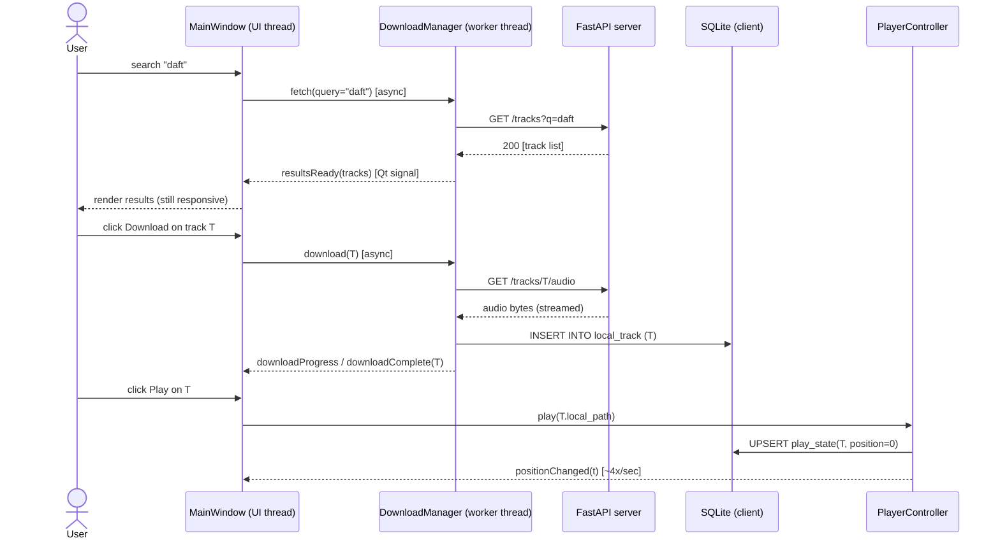
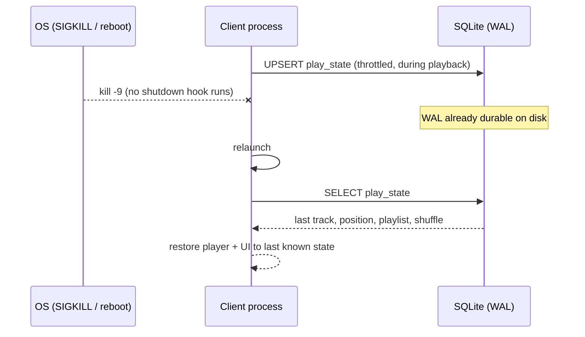

# DESIGN.md — Eureka Music App System

This document captures the architecture, the trade-offs behind it, and the plan
for meeting the assignment's functional and non-functional requirements. It
was written *before* any implementation code, and implementation follows the
decisions recorded here (deviations, if any, are called out in commit
messages and re-synced back into this file).

## 1. Goals / Non-goals

**Goals** (from the assignment brief):

- A FastAPI + Postgres server that is the single source of truth for a song
  catalog and its audio files (list/search, download, upload).
- A PySide2 desktop client for Ubuntu that browses the server catalog,
  downloads tracks, plays them locally (play/stop/continue/seek), manages
  playlists (shuffle, manual order, loop), and uploads local tracks back to
  the server.
- Non-functional: never freezes, <10s cold start at 8,000 tracks, survives
  SIGKILL/reboot without data loss, stable (bounded) memory usage.
- Seed scripts for both server and client driven by the FMA Small dataset.

**Explicit non-goals** (per the brief's "what we're not looking for"):
pixel-perfect UI, production auth, Spotify feature parity, cloud deployment,
cross-platform support, bundling copyrighted audio.

## 2. High-level architecture



Two independently deployable units, exactly as required:

- **Server**: FastAPI app + Postgres + file storage volume, packaged as a
  Docker image and run via `docker compose`. It owns the canonical catalog.
- **Client**: a Python3 desktop app using PySide2 for UI, with its own SQLite
  database for local library/playlist/state, run from a venv.

The client never talks to Postgres directly — all catalog access goes
through the server's REST API. This keeps the server the enforced source of
truth (a hard requirement) and lets the client work fully offline once
tracks are downloaded.

## 3. Server design

### 3.1 API style: REST over plain HTTP

**Decision: REST (resource-oriented, HTTP verbs, JSON), with `Range`-header
support on the download endpoint.**

Alternatives considered:

- *WebSocket*: no requirement for server-initiated push (no live multi-user
  sync, no chat-like feature). Would add connection-lifecycle complexity for
  no benefit here.
- *SSE*: useful for progress streams (e.g. upload progress), but the core
  operations (list, search, download, upload) are naturally
  request/response. Upload progress can be derived client-side from bytes
  sent, without SSE.
- *gRPC/streaming RPC*: better perf for very large payloads/streaming, but
  adds a codegen/toolchain cost that isn't justified for a catalog CRUD +
  file transfer workload, and FastAPI's REST ergonomics are a better fit for
  a small team that needs to move fast.

REST wins on simplicity, cacheability (`ETag`/`Last-Modified` on downloads),
debuggability (curl/Postman), and it maps 1:1 onto FastAPI's strengths
(automatic OpenAPI docs, Pydantic validation). `Range` support on
`GET /tracks/{id}/audio` is still included so a future streaming-playback
mode isn't precluded, even though the v1 client downloads-then-plays.

### 3.2 Data model (server / Postgres)



- `TRACK_FEATURE` backs the "similar tracks"/"recommend next" bonus
  features (§7) — a precomputed audio-content vector, one row per track
  that was successfully analyzed (a track can lack one if its clip was
  corrupt/unreadable at seed time). `JSON`, not a Postgres-only `ARRAY`,
  so the same model works against the SQLite DB the test suite runs
  against.
- Many-to-many `TRACK_GENRE` because FMA tracks carry multiple genre tags
  (`track/genres_all`, resolved against `fma_metadata/genres.csv`), not just
  the single `track/genre_top` used as a fallback when `genres_all` is empty
  or its ids aren't in `genres.csv`.
- `release_year`, `license`, `tags` surface the rest of tracks.csv's fields
  that the brief lists as in scope (`album`, `genres`, `tags`) rather than
  leaving them unused — see the seed script's parsing in §5.
- `checksum_sha256` lets both seed and upload paths de-duplicate identical
  files and lets the client verify a download completed correctly.
- Indexes: btree on `(lower(title))`, `(lower(artist))` for search-by-prefix,
  and a `pg_trgm` GIN index on title/artist for fuzzy substring search — both
  cheap to add and keep "search the catalog" snappy at 8,000 rows (trivial
  for Postgres, but sets up the right habit).

### 3.3 Endpoints (v1)

| Method | Path                        | Purpose                                   |
|--------|------------------------------|--------------------------------------------|
| GET    | `/health`                   | liveness/readiness for compose healthcheck |
| GET    | `/tracks`                   | list/search (`q`, `genre`, `limit`, `cursor`) |
| GET    | `/tracks/{id}`               | single track metadata                      |
| GET    | `/tracks/{id}/audio`         | download audio (supports `Range`)          |
| POST   | `/tracks`                    | upload new track (multipart: file + metadata) |
| GET    | `/tracks/{id}/similar`       | bonus: audio-content similarity ranking (§7) |
| GET    | `/tracks/{id}/recommend-next`| bonus: nearest unplayed track, `exclude` param (§7) |
| GET    | `/genres`                    | distinct genre list, for filter UI         |

Pagination is **cursor-based** (opaque cursor over `created_at,id`), not
offset-based — offset pagination degrades and can skip/duplicate rows under
concurrent inserts once the catalog is at FMA-Small scale; cursor pagination
stays O(page size) regardless of catalog size, which matters for the
client's "list a few thousand tracks without freezing" requirement.

### 3.4 Non-functional strategy (server)

- File writes (seed + upload) stream to a temp file, checksum, then atomic
  `rename()` into the storage volume — a crash mid-write never corrupts a
  served file.
- Postgres itself gives us crash-safe persistence (WAL) for metadata; no
  custom durability logic needed server-side.
- `docker compose` mounts the storage volume and DB volume as named volumes
  so `docker compose down` doesn't lose data.

## 4. Client design

### 4.1 Architecture: MVVM-ish, Qt Model/View, worker-thread IO

```mermaid
flowchart TB
    UI[Qt Widgets\nMainWindow, LibraryView, PlayerBar, PlaylistPanel]
    VM[View Models\nLibraryModel(QAbstractListModel), PlaylistModel]
    Services[Services\nApiClient, DownloadManager, PlayerController, PlaylistService]
    Local[(SQLite via QtSql / sqlite3)]
    FS[/Downloaded files/]
    Net[FastAPI server]

    UI --> VM --> Services
    Services --> Local
    Services --> FS
    Services --> Net
```

- **UI layer** never blocks: every action that touches the network or disk
  (search, download, upload, catalog refresh) is dispatched to a
  `QThreadPool` worker (`QRunnable` + `Signal` back to the UI thread). This
  is the direct mechanism behind the "never freeze/hang" requirement.
- **Playback** uses `QtMultimedia` (`QMediaPlayer` + `QAudioOutput`), which
  is GStreamer-backed on Ubuntu — we don't hand-roll audio decoding, which
  would be wasted effort per the brief ("not looking for... beyond what
  basic features need") and a reliability risk.
- **Library list** is backed by a `QAbstractListModel` reading from SQLite
  with `LIMIT/OFFSET` (or keyset) fetch-as-you-scroll, not a Python list of
  8,000 dicts — this is what keeps memory bounded and startup fast.

### 4.2 Data model (client / SQLite)



- `PLAY_EVENT` backs the listening-stats dashboard bonus feature (§7): one
  row per track actually started (logged from `PlayerController`'s normal
  playback path only, never from crash-resume restoration - resuming isn't
  a new listen). A brand-new table, so a plain `CREATE TABLE IF NOT EXISTS`
  is enough even on an existing install, unlike `local_track`'s added
  columns above.
- `LOCAL_TRACK.genres`/`tags` are denormalized comma-separated text, not a
  join table like the server's `TRACK_GENRE` — the client's SQLite schema is
  migrated non-destructively (`ALTER TABLE ADD COLUMN` on existing installs,
  see `client/app/database.py`), so a normalized many-to-many would need a
  real migration path this app doesn't otherwise need; the server remains
  the source of truth for genre data either way.
- `PLAY_STATE` is a single-row table updated on every play/pause/seek/track
  change (throttled to ~1 write/sec while playing) — this is what makes
  playback position/queue survive a SIGKILL or reboot, per the requirement.
  SQLite is opened in **WAL mode**, so these frequent small writes are cheap
  and crash-safe without an explicit "save on exit" hook (which a SIGKILL
  would skip anyway).
- Shuffle is implemented as a *view-order* concern (a shuffled index list
  kept in memory + `PLAY_STATE`), not a mutation of `PLAYLIST_TRACK.position`
  — manual ordering set by the user is never destroyed by toggling shuffle.

### 4.3 Sequence: browse → download → play



### 4.4 Sequence: crash-safe resume



### 4.5 Non-functional strategy (client)

| Requirement | Mechanism |
|---|---|
| Never freeze | All network/disk IO on `QThreadPool` workers; UI thread only renders and dispatches |
| Startup < 10s @ 8,000 tracks | SQLite indexed on title/artist; `QAbstractListModel` fetches a page (~200 rows) at a time, not the whole table; no network call blocks startup (cached catalog shown immediately, refreshed async) |
| Survives SIGKILL/reboot | SQLite WAL mode; `play_state` and playlist edits written immediately, not batched to exit; atomic rename for in-progress downloads so a killed download can't masquerade as a complete file |
| Stable memory | Single `QMediaPlayer` instance reused across tracks (not re-created per track); paginated models instead of materializing the full catalog; downloads streamed to disk in chunks, never buffered fully in memory |

## 5. Seeding strategy

Both seed scripts take the path to the *unzipped* FMA folder and an optional
`--limit N`:

- `server/scripts/seed.py <fma_root> [--limit N] [--api-url ...]`: parses
  `fma_metadata/tracks.csv`, inserts `TRACK`/`GENRE` rows, copies audio files
  into the server's storage volume (idempotent — re-running skips existing
  checksums).
- `client/scripts/seed.py <fma_root> [--limit N]`: populates the client's
  local SQLite + `storage/downloads/` directly, for local dev/demo without
  round-tripping through the server every time.

The dataset itself is never committed (`.gitignore` excludes
`fma_small/`, `fma_metadata/`, `*.mp3`, `*.zip`).

## 6. Testing & extensibility

- **Server**: `pytest` + `httpx.AsyncClient` against a test Postgres
  (docker-compose test profile or `pytest-postgresql`); unit tests for CRUD,
  integration tests for the upload→list→download round trip.
- **Client**: `pytest` for services/view-models (`ApiClient`,
  `PlaylistService`, shuffle logic) decoupled from Qt widgets; `pytest-qt`
  for the thin UI-integration layer where it earns its cost.
- **Typing/lint**: `mypy` + `ruff` (server and client), enforced via
  pre-commit; all public functions/methods carry type hints.
- **API docs**: FastAPI's generated OpenAPI/Swagger UI at `/docs`, no
  hand-maintained duplicate.

## 7. Bonus features

Implemented after the required minimum scope was solid and verified at
full scale. The first three are the assignment brief's own bonus-feature
examples; the last two are ours, chosen to be genuinely useful rather than
cosmetic (the brief explicitly deprioritizes visual polish).

1. **Now-playing visualizer** (`client/app/audio_levels.py` +
   `app/ui/visualizer_widget.py`): `QAudioProbe` taps real `QMediaPlayer`
   buffers; each buffer's raw PCM is FFT'd and collapsed into log-spaced
   bands (bass gets more bars than a linear split would give it) and
   rendered as 2D bars — no extra native deps beyond `numpy`. 2D over 3D
   was deliberate: the brief explicitly isn't grading visual polish, so the
   payoff is in the audio pipeline being real, not in the rendering. Since
   this project already hit real GStreamer-backend surprises elsewhere
   (duration()/pause() during crash-resume), the client starts a timeout on
   every track change and shows an honest "unavailable on this backend"
   message rather than a visualizer that just silently looks frozen, if no
   buffer ever arrives.
2. **Find similar tracks** (`server/app/audio_features.py`): a real
   audio-content signal, not a metadata heuristic — at seed/upload time,
   extract a 40-dim feature vector per track (mean+std of 20 MFCCs via
   `librosa`) and rank every other track by cosine similarity, exposed via
   `GET /tracks/{id}/similar`.
3. **Recommend next**: same feature space as above, `GET
   /tracks/{id}/recommend-next?exclude=...` — nearest *unplayed* track
   (caller passes already-played ids) to the one currently playing, with a
   small bonus for sharing a genre with the source track.
4. **Listening stats dashboard** (ours): a `play_event` log (one row per
   track actually started, explicitly not logged during crash-resume
   restoration) aggregated into total plays/listening time, top
   artists/genres, and recently played — a new "Stats" tab in the client.
5. **Playlist export/import via M3U** (ours): standard Extended M3U, real
   interoperability with other players. Import matches entries against the
   *local* library only (by path, falling back to filename so an .m3u from
   a different machine/install still resolves) — it never fetches a file
   the .m3u references that isn't already downloaded here, keeping the
   FMA-only sourcing rule intact.

## 8. Open questions / risks

- FMA Small is ~30GB zipped — seeding at full scale needs to be resumable
  (skip already-imported checksums) so a seed run can be restarted without
  starting over; addressed by the idempotent seed design in §5.
- 8,000-track startup budget assumes the client shows a cached page
  immediately and refreshes from the server asynchronously — first-ever run
  (empty cache) is explicitly allowed to differ, since nothing has been
  downloaded/seeded yet.
- Exact shuffle algorithm (Fisher–Yates over a per-playlist seed, re-rolled
  on each shuffle toggle) is an implementation detail, not re-litigated here.

## 9. Where things live

- [`AGENTS.md`](AGENTS.md) — conventions and guardrails for AI coding agents
  working in this repo.
- [`SKILLS.md`](SKILLS.md) — how AI was actually used while building this
  project (what was AI-drafted vs. human-directed).
- [`docs/diagrams/`](docs/diagrams/) — standalone copies of the diagrams
  above plus the C4 context/container views.
- [`server/README.md`](server/README.md) — server run/seed/verify instructions.
- [`client/README.md`](client/README.md) — client run/seed/verify instructions.
