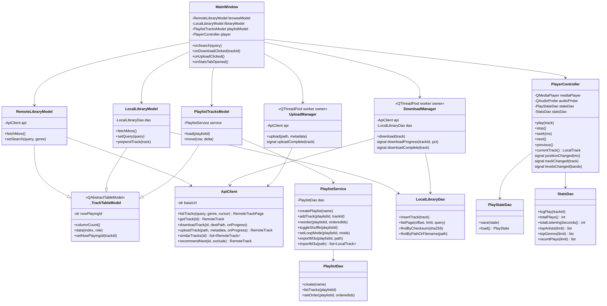

# Class — Client architecture (key classes)

`RemoteLibraryModel`/`LocalLibraryModel`/`PlaylistTracksModel` share the
`_TrackTableModel` base (a `QAbstractTableModel`, not a list model — see
`app/ui/models.py`) so all three tables get the same Title/Artist/Album/
Year/Genres/Duration columns and the same now-playing indicator, while
each subclass only owns its row source and fetch strategy.
