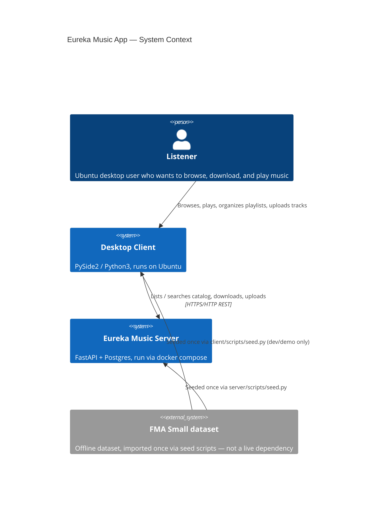

# C4 — Context

Notes:

- The server is the sole source of truth for the catalog; no third-party
  music service (Spotify/YouTube/etc.) is a dependency at runtime.
- The FMA dataset is an offline, one-time import source, not a running
  system — it never appears in the repository itself.
